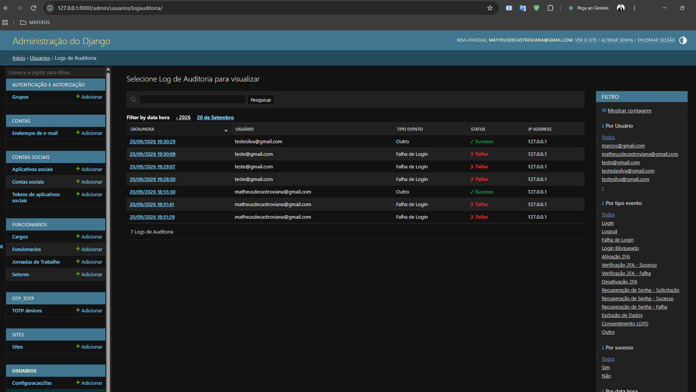
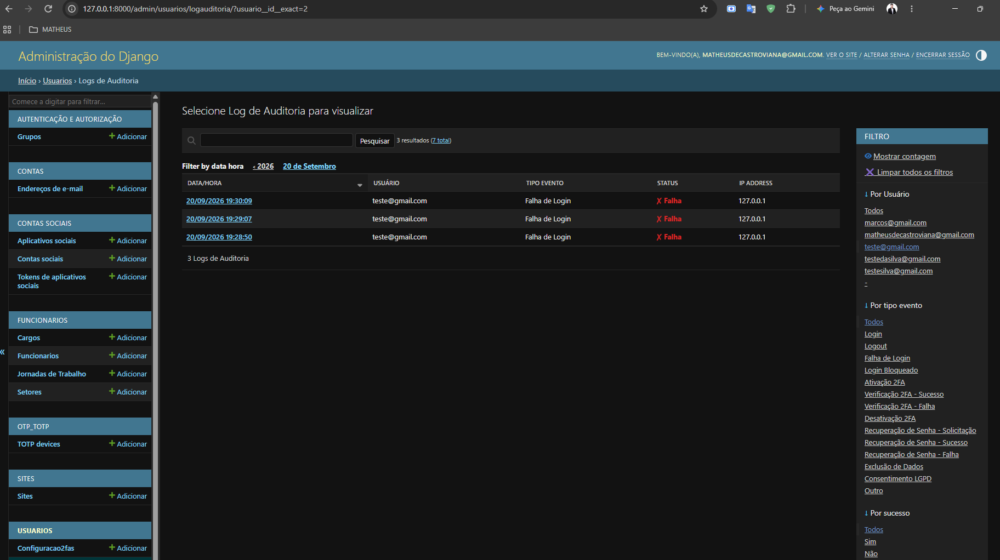

# Documentação — Módulo de Auditoria e Logs

**Projeto:** ERP Escola Profissionalizante
**Autores:** Marcos Antônio Ferreira de Araújo e Matheus de Castro Viana
**Versão do Documento:** 1.1
**Entrega:** Projeto Integrador — Auditoria e Logs

---

## Introdução

O módulo de auditoria garante rastreabilidade, responsabilização e detecção de incidentes de segurança. Os eventos são gravados em uma tabela dedicada do PostgreSQL (`usuarios_logauditoria`, modelo `LogAuditoria`), o que permite consultas relacionais e filtros. O registro em arquivo de texto foi removido; o logger `auditoria_seguranca` continua emitindo cada evento no console, útil em desenvolvimento e na saída de logs da hospedagem.

Toda a geração de eventos está centralizada em `usuarios/audit.py`. Cada função monta uma mensagem padronizada, emite no logger (nível `INFO` para sucesso e `WARNING` para falha) e grava na tabela. Se a gravação no banco falhar, o erro é registrado no logger e o fluxo do usuário não é interrompido.

Os logs não armazenam senhas, tokens completos nem códigos 2FA: nenhuma das funções de auditoria recebe esses valores como parâmetro.

### Estrutura do modelo `LogAuditoria`

| Campo | Descrição |
|---|---|
| `usuario` | FK para o usuário (nula para e-mail inexistente; `SET_NULL` ao excluir o usuário) |
| `tipo_evento` | Tipo do evento, com escolhas predefinidas e índice |
| `data_hora` | Preenchida automaticamente na criação, com índice |
| `ip_address` | IP do cliente |
| `user_agent` | Campo disponível no modelo |
| `sucesso` | Resultado da operação |
| `mensagem` | Texto descritivo padronizado |
| `detalhes` | JSON com metadados do evento |

### Tipos de evento

| Grupo | Tipos |
|---|---|
| Autenticação | `login`, `logout`, `login_falha`, `login_bloqueado` |
| 2FA | `2fa_ativacao`, `2fa_verificacao_sucesso`, `2fa_verificacao_falha`, `2fa_desativacao`, `2fa_bloqueio`, `2fa_sessao_expirada` |
| Recuperação de senha | `recuperacao_senha_solicitacao`, `recuperacao_senha_sucesso`, `recuperacao_senha_falha` |
| LGPD | `consentimento_lgpd`, `exportacao_dados`, `exclusao_dados` |
| Outros | `outro` |

Nas falhas de login, o motivo específico (`login_falha_senha`, `login_falha_usuario_inexistente` ou `login_falha_conta_inativa`) fica registrado na `mensagem`. Quando o e-mail informado não existe, o e-mail tentado é guardado em `detalhes`.

---

## Logs de autenticação registrados (RA 5.1)

**Requisito:** O sistema deverá registrar logs de autenticação, incluindo sucesso, falha, logout, bloqueio e eventos relevantes de sessão.

### Decisão adotada

`registrar_evento_autenticacao` é chamada pelo `UsuarioBackend` (sucesso, senha incorreta, usuário inexistente, conta inativa e login bloqueado) e pela view `logout_usuario` (logout). Eventos de sessão relevantes do 2FA (verificação, bloqueio e expiração da etapa pendente) são registrados por `registrar_evento_2fa`.

**IP do cliente:** em produção a aplicação roda atrás de um proxy, e `REMOTE_ADDR` traria o IP do proxy. O `IPClienteMiddleware` (`usuarios/middleware.py`) substitui `REMOTE_ADDR` pelo valor do cabeçalho configurado em `IP_CLIENTE_CABECALHO` (`HTTP_TRUE_CLIENT_IP`) quando é um endereço IP válido; caso contrário, mantém o original. Em desenvolvimento o middleware fica desligado.

### Justificativa técnica

O registro centralizado em banco, em vez de arquivos soltos, favorece a integridade e a disponibilidade da informação. Os índices em `data_hora`, `usuario` e `tipo_evento` aceleram consultas forenses por período, usuário ou tipo.

### Evidências

- **Código:** `usuarios/models.py` (`LogAuditoria`), `usuarios/audit.py`, `usuarios/backends.py`, `usuarios/middleware.py`
- **Testes automatizados:** `usuarios/test_ip_cliente.py` (IP do cliente na auditoria)
- **Print:** 

---

## Logs de falhas e 2FA sem expor dados sensíveis (RA 5.2)

**Requisito:** O sistema deverá registrar logs de falhas de autenticação e eventos relacionados ao 2FA, sem registrar senhas ou códigos completos.

### Decisão adotada

As funções `registrar_evento_2fa`, `registrar_evento_autenticacao`, `registrar_evento_recuperacao_senha` e `registrar_resultado_recuperacao_senha` registram apenas o contexto do evento: usuário, tipo, resultado, IP e um motivo textual. O código TOTP, a senha e o token de recuperação não são parâmetros dessas funções e, portanto, não chegam à mensagem nem ao campo `detalhes`.

Exemplo de registro de falha no 2FA:

> `Evento 2FA | Usuário: teste@email.com | Evento: verificacao_falha | Sucesso: False | IP: 127.0.0.1 | Detalhes: Token inválido`

Eventos de 2FA registrados: ativação (sucesso e falha), tentativa bloqueada de desativação, verificação com sucesso, verificação com falha, bloqueio após `TWOFA_MAX_TENTATIVAS` códigos inválidos e expiração do tempo para informar o código.

### Justificativa técnica

Segredos em log representariam uma vulnerabilidade crítica, pois qualquer pessoa com acesso de leitura aos logs poderia reutilizá-los. Registrar somente o resultado e um motivo genérico preserva a capacidade de auditoria sem comprometer a confidencialidade.

### Evidências

- **Código:** `usuarios/audit.py` (`registrar_evento_2fa`, `registrar_resultado_recuperacao_senha`)
- **Testes automatizados:** `usuarios/test_2fa_cifrado.py` (fluxo e bloqueio do 2FA)

---

## Proteção contra alteração dos logs (RA 5.3)

**Requisito:** Os logs deverão possuir proteção contra alteração ou exclusão indevida, por meio de controle de acesso, armazenamento protegido, integridade ou mecanismo equivalente.

### Decisão adotada

A proteção é aplicada em duas camadas.

**1. Camada de modelo** (`usuarios/models.py`):

- `LogAuditoria.save()` levanta `PermissionDenied` quando o registro já existe, portanto só é possível criar, nunca editar.
- `LogAuditoria.delete()` levanta `PermissionDenied`.
- O manager customizado (`LogAuditoriaQuerySet`) bloqueia `update()` e `delete()` em lote.

**2. Camada de interface** (`LogAuditoriaAdmin`, `usuarios/admin.py`):

- `has_add_permission`, `has_change_permission` e `has_delete_permission` retornam `False`, inclusive para superusuários.
- Todos os campos são somente leitura.

O acesso à tela de logs é restrito a usuários do Django Admin, que exige login, 2FA ativo e permissão de staff.

### Justificativa técnica

Impedir que administradores editem ou apaguem logs preserva as evidências em investigações de incidentes. A proteção na camada de modelo vale para qualquer código da aplicação, não só para o Admin. Limitação conhecida: um acesso direto ao banco de dados, com credenciais do PostgreSQL, não passa pela aplicação; por isso as credenciais do banco ficam em variáveis de ambiente (ver `criptografia.md`).

### Evidências

- **Código:** `usuarios/models.py` (`LogAuditoria`, `LogAuditoriaQuerySet`), `usuarios/admin.py` (`LogAuditoriaAdmin`)

---

## Exemplo de análise de logs (RA 5.4)

**Requisito:** O projeto deverá apresentar um exemplo de análise de logs, demonstrando como identificar uma sequência de falhas, um bloqueio ou uma tentativa de acesso suspeita.

### Ferramentas de análise

O Django Admin (`LogAuditoriaAdmin`) oferece:

- **Filtro por usuário:** isola a atividade de uma conta.
- **Filtro por tipo de evento:** por exemplo, "Falha de Login" ou "Login Bloqueado".
- **Filtro por sucesso:** isola tentativas malsucedidas.
- **Filtro e hierarquia por data:** delimitam o período.
- **Busca por IP, e-mail ou texto da mensagem.**

### Exemplo de análise: sequência de falhas até o bloqueio

Cenário: investigar a conta `usuario@exemplo.com`.

1. Filtrar por **Usuário = usuario@exemplo.com** e **Sucesso = Não**.
2. Ordenar por data (padrão: mais recente primeiro) e observar uma sequência de eventos `Falha de Login` em curto intervalo, todos com o mesmo IP.
3. Na quinta falha consecutiva aparece o evento `Login Bloqueado` nas tentativas seguintes, indicando que o limite de `LOGIN_MAX_TENTATIVAS` foi atingido.
4. Buscar pelo IP de origem para verificar se o mesmo endereço tentou outras contas, o que indicaria varredura de contas.
5. Se após o bloqueio houver eventos `Login` (sucesso) seguidos de `2FA - Verificação Falha` e `Bloqueio 2FA`, a senha foi descoberta e o atacante parou no segundo fator.

Padrão de tentativa suspeita de enumeração: vários eventos `Recuperação de Senha - Solicitação` com `Sucesso = Não` (e-mail não encontrado) e o mesmo IP em pouco tempo.

### Evidências

- **Print:** 

---

## Acesso e retenção

- **Acesso:** a consulta aos logs é restrita aos administradores do sistema (Django Admin com 2FA obrigatório).
- **Retenção:** os registros de auditoria são mantidos enquanto forem necessários à finalidade de segurança e auditoria descrita na Política de Privacidade. O sistema não possui rotina de exclusão automática, e a exclusão pela aplicação é impedida pela proteção descrita acima.

---

## Histórico de alterações

| Versão | Data | Alteração | Responsável |
|---|---|---|---|
| 1.0 | 20/09/2026 | Criação do documento | Matheus de Castro Viana e Marcos Antônio Ferreira de Araújo |
| 1.1 | 18/10/2026 | Revisão: proteção em camada de modelo, novos tipos de evento (2FA, exportação), IP do cliente, remoção do log em arquivo, exemplo de análise e acesso e retenção | Marcos Antônio Ferreira de Araújo e Matheus de Castro Viana |