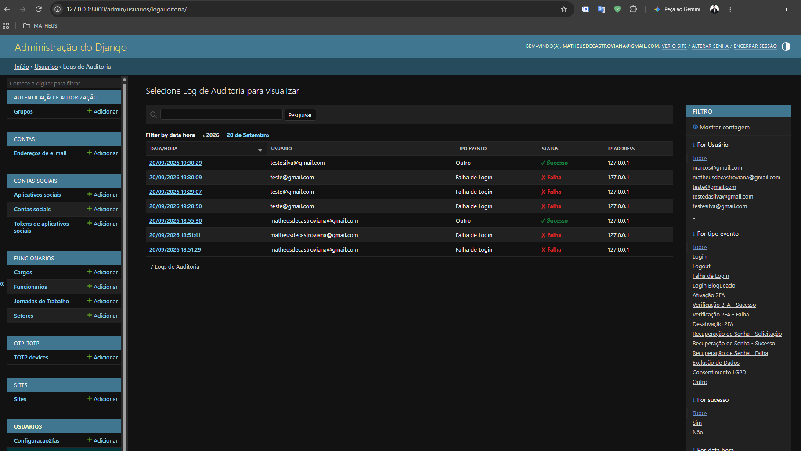

# Documentação — Módulo de Auditoria e Logs

**Projeto:** ERP Escola Profissionalizante
**Autores:** Marcos Antônio Ferreira de Araújo e Matheus de Castro Viana
**Versão do Documento:** 1.1
**Entrega:** Projeto Integrador — Auditoria e Logs

---

## Introdução

O módulo de auditoria garante rastreabilidade, responsabilização e detecção de incidentes de segurança. Os eventos são gravados em uma tabela dedicada do PostgreSQL (`usuarios_logauditoria`, modelo `LogAuditoria`), o que permite consultas relacionais e filtros. O registro em arquivo de texto foi removido; o logger `auditoria_seguranca` continua emitindo cada evento no console, útil em desenvolvimento e na saída de logs da hospedagem.

Toda a geração de eventos está centralizada em `usuarios/audit.py`. Cada função monta uma mensagem padronizada, emite no logger (nível `INFO` para sucesso e `WARNING` para falha) e grava na tabela. Se a gravação no banco falhar, o erro é registrado no logger e o fluxo do usuário não é interrompido.

Os logs não armazenam senhas, tokens completos nem códigos 2FA: nenhuma das funções de auditoria recebe esses valores como parâmetro.

### Estrutura do modelo `LogAuditoria`

| Campo | Descrição |
|---|---|
| `usuario` | FK para o usuário (nula para e-mail inexistente; `SET_NULL` ao excluir o usuário) |
| `tipo_evento` | Tipo do evento, com escolhas predefinidas e índice |
| `data_hora` | Preenchida automaticamente na criação, com índice |
| `ip_address` | IP do cliente |
| `user_agent` | Campo disponível no modelo |
| `sucesso` | Resultado da operação |
| `mensagem` | Texto descritivo padronizado |
| `detalhes` | JSON com metadados do evento |

### Tipos de evento

| Grupo | Tipos |
|---|---|
| Autenticação | `login`, `logout`, `login_falha`, `login_bloqueado` |
| 2FA | `2fa_ativacao`, `2fa_verificacao_sucesso`, `2fa_verificacao_falha`, `2fa_desativacao`, `2fa_bloqueio`, `2fa_sessao_expirada` |
| Recuperação de senha | `recuperacao_senha_solicitacao`, `recuperacao_senha_sucesso`, `recuperacao_senha_falha` |
| LGPD | `consentimento_lgpd`, `exportacao_dados`, `exclusao_dados` |
| Outros | `outro` |

Nas falhas de login, o motivo específico (`login_falha_senha`, `login_falha_usuario_inexistente` ou `login_falha_conta_inativa`) fica registrado na `mensagem`. Quando o e-mail informado não existe, o e-mail tentado é guardado em `detalhes`.

---

## Logs de autenticação registrados (RA 5.1)

**Requisito:** O sistema deverá registrar logs de autenticação, incluindo sucesso, falha, logout, bloqueio e eventos relevantes de sessão.

### Decisão adotada

`registrar_evento_autenticacao` é chamada pelo `UsuarioBackend` (sucesso, senha incorreta, usuário inexistente, conta inativa e login bloqueado) e pela view `logout_usuario` (logout). Eventos de sessão relevantes do 2FA (verificação, bloqueio e expiração da etapa pendente) são registrados por `registrar_evento_2fa`.

**IP do cliente:** em produção a aplicação roda atrás de um proxy, e `REMOTE_ADDR` traria o IP do proxy. O `IPClienteMiddleware` (`usuarios/middleware.py`) substitui `REMOTE_ADDR` pelo valor do cabeçalho configurado em `IP_CLIENTE_CABECALHO` (`HTTP_TRUE_CLIENT_IP`) quando é um endereço IP válido; caso contrário, mantém o original. Em desenvolvimento o middleware fica desligado.

### Justificativa técnica

O registro centralizado em banco, em vez de arquivos soltos, favorece a integridade e a disponibilidade da informação. Os índices em `data_hora`, `usuario` e `tipo_evento` aceleram consultas forenses por período, usuário ou tipo.

### Evidências

- **Código:** `usuarios/models.py` (`LogAuditoria`), `usuarios/audit.py`, `usuarios/backends.py`, `usuarios/middleware.py`
- **Testes automatizados:** `usuarios/test_ip_cliente.py` (IP do cliente na auditoria)
- **Print:** 

---

## Logs de falhas e 2FA sem expor dados sensíveis (RA 5.2)

**Requisito:** O sistema deverá registrar logs de falhas de autenticação e eventos relacionados ao 2FA, sem registrar senhas ou códigos completos.

### Decisão adotada

As funções `registrar_evento_2fa`, `registrar_evento_autenticacao`, `registrar_evento_recuperacao_senha` e `registrar_resultado_recuperacao_senha` registram apenas o contexto do evento: usuário, tipo, resultado, IP e um motivo textual. O código TOTP, a senha e o token de recuperação não são parâmetros dessas funções e, portanto, não chegam à mensagem nem ao campo `detalhes`.

Exemplo de registro de falha no 2FA:

> `Evento 2FA | Usuário: teste@email.com | Evento: verificacao_falha | Sucesso: False | IP: 127.0.0.1 | Detalhes: Token inválido`

Eventos de 2FA registrados: ativação (sucesso e falha), tentativa bloqueada de desativação, verificação com sucesso, verificação com falha, bloqueio após `TWOFA_MAX_TENTATIVAS` códigos inválidos e expiração do tempo para informar o código.

### Justificativa técnica

Segredos em log representariam uma vulnerabilidade crítica, pois qualquer pessoa com acesso de leitura aos logs poderia reutilizá-los. Registrar somente o resultado e um motivo genérico preserva a capacidade de auditoria sem comprometer a confidencialidade.

### Evidências

- **Código:** `usuarios/audit.py` (`registrar_evento_2fa`, `registrar_resultado_recuperacao_senha`)
- **Testes automatizados:** `usuarios/test_2fa_cifrado.py` (fluxo e bloqueio do 2FA)

---

## Logs de consentimento LGPD

**Requisito:** Registrar de forma auditável os eventos de consentimento e de revogação, sem expor dados desnecessários.

### Decisão adotada

Os eventos de consentimento entram no `LogAuditoria` com `tipo_evento = 'consentimento_lgpd'` (rótulo "Consentimento LGPD" no admin), em três situações:

- **Aceite e recusa:** função `registrar_consentimento` em `usuarios/audit.py`. O campo `detalhes` guarda `tipo`, `versao` e `aceitou`.
- **Revogação:** função `registrar_evento_lgpd` com o evento `revogacao_consentimento`. O campo `detalhes` guarda `evento_lgpd` e `tipo`. Antes, a revogação era gravada com o tipo genérico `outro`; agora fica na mesma trilha dos aceites, podendo ser consultada com um único filtro.

A mensagem do log traz e-mail do usuário, tipo, versão, status e IP. O texto integral apresentado ao titular não é gravado no log: a prova completa fica na tabela `usuarios_consentimentolgpd` (hash SHA-256 do texto, IP, user-agent, URL de origem e datas). As duas tabelas se complementam: o `LogAuditoria` dá a linha do tempo geral de segurança e o `ConsentimentoLGPD` guarda a prova de cada manifestação.

### Justificativa técnica

Registrar aceite, recusa e revogação na mesma trilha imutável permite reconstituir, para qualquer titular, quando e em que versão do texto ele consentiu ou revogou, e faz com que a trilha herde a proteção por trigger descrita acima. Manter o texto fora do log evita duplicar conteúdo e mantém a mensagem curta.

### Evidências

- **Código:** `usuarios/audit.py` (`registrar_consentimento` e `registrar_evento_lgpd`)
- **Testes:** `usuarios/test_consentimento.py` (conferem a criação dos eventos `consentimento_lgpd` no aceite e na revogação)
- **Print:** `evidencias/logs_consentimento_lgpd.png` (admin filtrado pelo tipo de evento "Consentimento LGPD")

---

## Proteção contra alteração dos logs

**Requisito:** Os logs deverão possuir proteção contra alteração ou exclusão indevida, por meio de controle de acesso, armazenamento protegido, integridade ou mecanismo equivalente.

### Decisão adotada

A proteção é aplicada em duas camadas.

**1. Camada de modelo** (`usuarios/models.py`):

- `LogAuditoria.save()` levanta `PermissionDenied` quando o registro já existe, portanto só é possível criar, nunca editar.
- `LogAuditoria.delete()` levanta `PermissionDenied`.
- O manager customizado (`LogAuditoriaQuerySet`) bloqueia `update()` e `delete()` em lote.

**2. Camada de interface** (`LogAuditoriaAdmin`, `usuarios/admin.py`):

- `has_add_permission`, `has_change_permission` e `has_delete_permission` retornam `False`, inclusive para superusuários.
- Todos os campos são somente leitura.

O acesso à tela de logs é restrito a usuários do Django Admin, que exige login, 2FA ativo e permissão de staff.

### Justificativa técnica

Impedir que administradores editem ou apaguem logs preserva as evidências em investigações de incidentes. A proteção na camada de modelo vale para qualquer código da aplicação, não só para o Admin. Limitação conhecida: um acesso direto ao banco de dados, com credenciais do PostgreSQL, não passa pela aplicação; por isso as credenciais do banco ficam em variáveis de ambiente (ver `criptografia.md`).

### Evidências

- **Código:** `usuarios/models.py` (`LogAuditoria`, `LogAuditoriaQuerySet`), `usuarios/admin.py` (`LogAuditoriaAdmin`)

---

## Proteção por trigger no banco de dados (PostgreSQL)

**Requisito:** A tabela de logs de auditoria deve ser protegida no nível do banco de dados, impedindo alterações ou exclusões mesmo que alguém consiga burlar as camadas de aplicação.

### Decisão adotada

A proteção foi implementada no próprio PostgreSQL, com `migrations.RunSQL` na migration `usuarios.0013_bloquear_alteracao_logauditoria`, que cria:

1. **Função PL/pgSQL `usuarios_bloquear_alteracao_logauditoria()`**: dispara `RAISE EXCEPTION` sempre que é chamada.
2. **Trigger `usuarios_trigger_bloquear_alteracao_logauditoria`**: `BEFORE UPDATE OR DELETE OR TRUNCATE` em nível de statement (`FOR EACH STATEMENT`) na tabela `usuarios_logauditoria`, vinculado à função acima.

Com isso, qualquer `UPDATE`, `DELETE` ou `TRUNCATE` via SQL cru é recusado pelo banco, inclusive quando a instrução não afeta nenhuma linha. O `INSERT` continua permitido, pois é o que grava os novos logs. O `TRUNCATE` é coberto pelo próprio trigger de tabela, sem exigir privilégio de superusuário.

### Ajuste no campo `usuario` da model

O campo `usuario` de `LogAuditoria` usava `on_delete=models.SET_NULL`. Isso faria o Django executar um `UPDATE` na tabela de logs para zerar a chave estrangeira ao excluir um usuário, o que conflitaria com o trigger.

**Decisão:** o campo passou a usar `on_delete=models.PROTECT` (migration `usuarios.0014_alter_logauditoria_usuario`). Um usuário que possui logs não pode ser excluído: o Django recusa a operação com `ProtectedError`, e o histórico continua íntegro e vinculado ao usuário. O desligamento de um usuário deve ser feito por inativação, nunca por exclusão.

### Limitações de segurança

- O dono (owner) da tabela ou um superusuário do banco ainda pode executar `DROP TRIGGER` e remover a proteção. O trigger protege contra alterações acidentais ou maliciosas feitas por usuários comuns da aplicação, mas não substitui controles de acesso no nível do banco (revogação de privilégios, auditoria de superusuários).
- Como o `TRUNCATE` na tabela é bloqueado, comandos que esvaziam todas as tabelas, como `manage.py flush` e `TransactionTestCase`, também são bloqueados. O projeto usa apenas `TestCase`, que não é afetado.

### Simulação de erro ao tentar alterar a tabela

```sql
-- Tentativa de UPDATE via SQL cru
UPDATE usuarios_logauditoria SET mensagem = 'tentativa de alteracao' WHERE id = 1;
-- ERRO:  Operação não permitida na tabela usuarios_logauditoria: logs de auditoria são imutáveis.

-- Tentativa de DELETE via SQL cru
DELETE FROM usuarios_logauditoria WHERE id = 1;
-- ERRO:  Operação não permitida na tabela usuarios_logauditoria: logs de auditoria são imutáveis.

-- Tentativa de TRUNCATE via SQL cru
TRUNCATE TABLE usuarios_logauditoria;
-- ERRO:  Operação não permitida na tabela usuarios_logauditoria: logs de auditoria são imutáveis.
```

### Evidências

- **Código:** `usuarios/migrations/0013_bloquear_alteracao_logauditoria.py` (função e trigger via `migrations.RunSQL`).
- **Código:** `usuarios/models.py` (campo `usuario` de `LogAuditoria` com `on_delete=models.PROTECT`) e `usuarios/migrations/0014_alter_logauditoria_usuario.py`.
- **Teste:** `usuarios/test_trigger_logauditoria.py`, que dispara `UPDATE`, `DELETE` e `TRUNCATE` por SQL cru e exige a mensagem de bloqueio do banco, confere que novos logs ainda podem ser inseridos e que um usuário com logs não pode ser excluído.
- **Comando:** `python manage.py test usuarios.test_trigger_logauditoria -v 2`

## Exemplo de análise de logs apresentado

**Requisito:** O projeto deverá apresentar um exemplo de análise de logs, demonstrando como identificar uma sequência de falhas, um bloqueio ou uma tentativa de acesso suspeita.

### Ferramentas de análise

O painel administrativo foi estruturado para funcionar como uma ferramenta de análise forense, utilizando os recursos nativos do Django Admin:
- **Filtro por Usuário:** Dropdown lateral para isolar a atividade de um usuário específico.
- **Filtro por Tipo de Evento:** Permite visualizar apenas "Falha de Login" ou "Login Bloqueado".
- **Filtro por Sucesso:** Isola tentativas mal-sucedidas.
- **Filtro por IP:** Campo de pesquisa para rastrear acessos de origens suspeitas.

## Histórico de alterações

| Versão | Data | Alteração | Responsável |
|---|---|---|---|
| 1.0 | 20/09/2026 | Primeira versão do documento | Marcos Antônio Ferreira de Araújo e Matheus de Castro Viana |
| 1.1 | 03/11/2026 | Proteção por trigger no banco de dados | Marcos Antônio Ferreira de Araújo |
| 1.2 | 04/11/2026 | Logs de consentimento LGPD (aceite, recusa e revogação no mesmo tipo de evento) | Matheus de Castro Viana |
