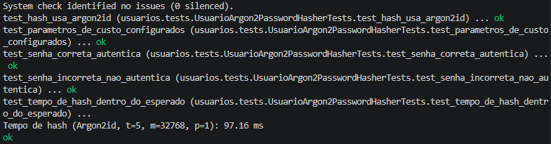
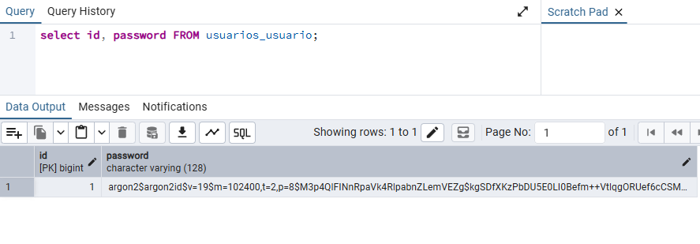
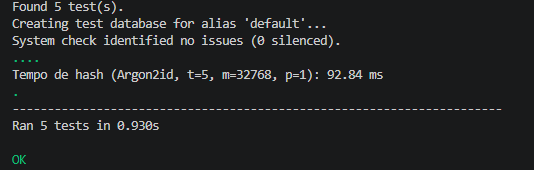
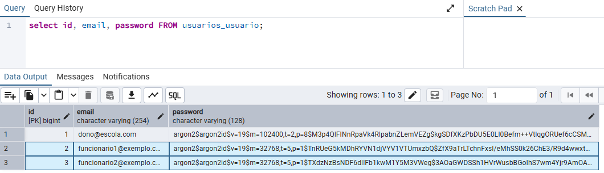
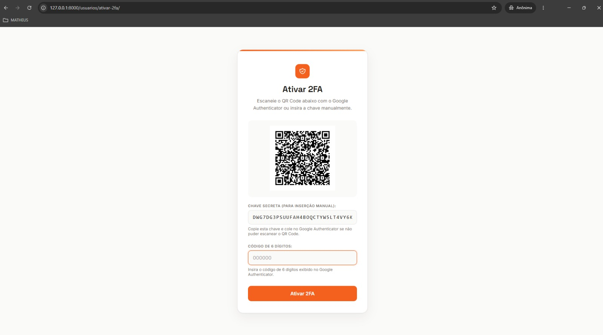
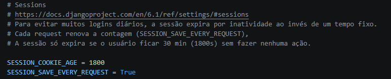
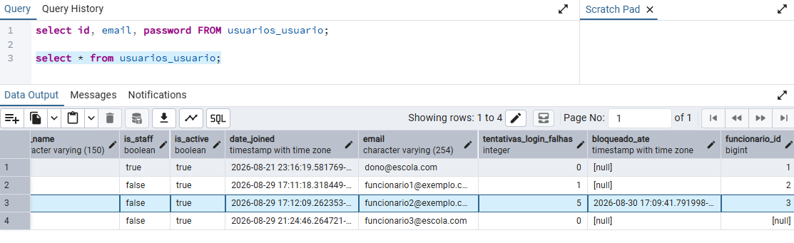

# Autenticação e Gestão de Credenciais

**Projeto:** ERP Escola Profissionalizante
**Autores:** Marcos Antônio Ferreira de Araújo e Matheus de Castro Viana
**Versão do Documento:** 1.3
**Entrega:** Projeto Integrador — Autenticação e Gestão de Credenciais

---

## 1. Visão geral

A autenticação é composta por:

- um modelo de usuário próprio com login por e-mail (`usuarios/models.py`);
- um backend de autenticação customizado (`usuarios/backends.py`);
- um hasher de senha baseado em Argon2id com parâmetros próprios (`usuarios/hashers.py`);
- um adapter do django-allauth que intercepta o login para exigir o segundo fator (`usuarios/adapters.py`);
- um middleware que torna o 2FA obrigatório para todos os usuários (`usuarios/middleware.py`);
- registro de eventos em auditoria (`usuarios/audit.py`).

O cadastro público está fechado: tanto o cadastro por formulário quanto o por conta social são recusados (`is_open_for_signup` retorna `False` em `Custom2FAAccountAdapter` e em `SocialAccountAdapterFechado`). Usuários são criados por administradores, e todo usuário comum precisa estar vinculado a um `Funcionario`.

## 2. Requisitos detalhados

### RS 1.1 — Hash criptográfico seguro para senhas

**Requisito:** O sistema deverá utilizar hash criptográfico seguro para armazenar senhas, utilizando Argon2, bcrypt ou PBKDF2.

**Decisão adotada**
Foi criada a subclasse `UsuarioArgon2PasswordHasher` (`usuarios/hashers.py`), que usa Argon2id. Em `config/settings.py`, `PASSWORD_HASHERS` coloca esse hasher em primeiro lugar, com o `PBKDF2PasswordHasher` do Django como fallback. O Django migra automaticamente um hash PBKDF2 antigo para Argon2id quando o usuário faz login com sucesso.

**Justificativa técnica**
Argon2id é o algoritmo recomendado pela OWASP para armazenamento de senhas, por ser resistente a ataques com GPU e ASIC. O PBKDF2 permanece como fallback apenas para que hashes antigos continuem verificáveis; o próprio login os converte.

**Evidência**
- Teste automatizado: `usuarios/tests.py::test_hash_usa_argon2id`
- 
- 

---

### RS 1.2 — Parâmetros de custo do hash

**Requisito:** Os parâmetros de custo do algoritmo de hash deverão ser configurados de forma adequada ao ambiente do sistema.

**Decisão adotada**
Em `usuarios/hashers.py`: `time_cost = 5`, `memory_cost = 32768` (32 MiB) e `parallelism = 1`, sobrescrevendo o padrão do `Argon2PasswordHasher` do Django (`parallelism = 8`).

**Justificativa técnica**
A configuração mínima recomendada pela OWASP para Argon2id é 19 MiB de memória, 2 iterações e paralelismo 1. Os valores adotados ficam acima desse mínimo. O paralelismo 1 evita consumir vários núcleos por operação em ambiente de hospedagem compartilhado. O tempo de hash medido ficou em torno de 94 ms por operação, aceitável para o usuário sem enfraquecer a proteção.

**Evidência**
- Teste automatizado: `usuarios/tests.py::test_parametros_de_custo_configurados` e `test_tempo_de_hash_dentro_do_esperado`
- 

---

### RS 1.3 — Salt criptográfico único por senha

**Requisito:** O sistema deverá utilizar um salt criptográfico único para cada senha ou usuário.

**Decisão adotada**
Nenhuma configuração manual foi necessária: o Argon2id e o PBKDF2 do Django geram um salt aleatório a cada chamada de `set_password()`, armazenado junto ao hash no campo `password`. Não há nenhum ponto da configuração que desabilite a geração do salt.

**Justificativa técnica**
Salt único por senha impede ataques com tabelas pré-computadas e faz com que senhas iguais gerem hashes diferentes.

**Evidência**
- 

---

### RS 1.4 — Armazenamento correto do hash e metadados

**Requisito:** O armazenamento deverá manter corretamente o hash e os metadados necessários, sem armazenar a senha original.

**Decisão adotada**
O campo `password` armazena a string completa gerada pelo hasher (algoritmo, versão, parâmetros de custo, salt e hash), no formato `argon2$argon2id$v=19$m=32768,t=5,p=1$...`. O `UsuarioManager.create_user` chama `set_password()` antes de qualquer `save()`, portanto a senha em texto puro nunca é persistida.

**Justificativa técnica**
Guardar os metadados na própria string evita inconsistência entre o algoritmo registrado e o realmente usado. Se os parâmetros de custo mudarem no futuro, os hashes antigos continuam verificáveis.

**Evidência**
- Testes automatizados: `usuarios/tests.py::test_senha_correta_autentica` e `test_senha_incorreta_nao_autentica`
- 

---

### RS 1.5 — Autenticação de dois fatores (2FA)

**Requisito:** O sistema deverá implementar autenticação de dois fatores (2FA) para os perfis definidos como obrigatórios pelo projeto.

**Decisão adotada**
O 2FA é baseado em TOTP (RFC 6238) com a biblioteca PyOTP, compatível com Google Authenticator, Authy e Microsoft Authenticator. **O projeto definiu que todos os perfis são obrigatórios.**

Componentes:

- **Modelo `Configuracao2FA`** (`usuarios/models_2fa.py`): relação um-para-um com o usuário. Armazena a chave secreta TOTP em base32 gerada por `pyotp.random_base32()`, o status `ativado`, o contador `tentativas_falhas`, `criado_em` e `ultimo_uso`. A `chave_secreta` é um `CampoCifrado`: fica **cifrada em repouso** com Fernet (ver `criptografia.md`).
- **Ativação** (`usuarios/views_2fa.py::ativar_2fa`): o usuário escaneia o QR Code gerado por `get_qrcode_base64()` ou digita a chave manualmente. O 2FA só é marcado como `ativado` depois que o usuário informa um código válido de 6 dígitos, o que evita bloquear uma conta por QR Code escaneado incorretamente.
- **Obrigatoriedade** (`usuarios/middleware.py::Exigir2FAMiddleware`): todo usuário autenticado sem 2FA ativado é redirecionado para a tela de ativação em qualquer rota, inclusive o Django Admin. Ficam liberadas apenas a própria ativação, o logout, a política de privacidade, os termos de uso e o registro de consentimento. O login do admin (`/admin/login/`) é redirecionado para o login do allauth, de modo que não existe porta de entrada sem 2FA.
- **Desativação** (`usuarios/views_2fa.py::desativar_2fa`): não é permitida. A view apenas registra a tentativa bloqueada no log de auditoria e informa que o 2FA é obrigatório.
- O admin do Django não exibe nem permite editar a `chave_secreta`.

**Justificativa técnica**
TOTP foi escolhido em detrimento de SMS porque (1) é um padrão aberto e suportado por aplicativos gratuitos; (2) não depende de operadora, evitando custos e falhas de entrega; (3) não está sujeito a SIM swap. A obrigatoriedade para todos os perfis elimina contas sem segundo fator, que seriam o elo mais fraco do sistema.

**Evidência**
- Código-fonte: `usuarios/models_2fa.py`, `usuarios/views_2fa.py`, `usuarios/middleware.py`
- Testes automatizados: `usuarios/test_ajustes_seguranca.py::DoisFatoresObrigatorioTests` e `usuarios/test_2fa_cifrado.py::FluxoDoisFatoresComChaveCifradaTests`
- Migração: `usuarios/migrations/0003_configuracao2fa.py`
- 

---

### RS 1.6 — Validação do 2FA após a autenticação primária

**Requisito:** O sistema deverá validar o segundo fator somente após a validação da autenticação primária.

**Decisão adotada**
O `Custom2FAAccountAdapter` (`usuarios/adapters.py`) sobrescreve `pre_login()`, hook que o allauth chama depois de validar e-mail e senha (via `UsuarioBackend`, incluindo o bloqueio por força bruta) e antes de criar a sessão.

Fluxo:

1. O usuário envia e-mail e senha em `/accounts/login/`.
2. `UsuarioBackend.authenticate()` valida as credenciais e retorna o `Usuario` (ou `None`).
3. O allauth chama `pre_login()`. Se o usuário tem `config_2fa.ativado`, o adapter grava em `request.session` o `usuario_pendente_2fa` e o instante `usuario_pendente_2fa_em`, e redireciona para `/usuarios/verify-2fa/`. Nenhuma sessão autenticada existe nesse ponto.
4. A view `verificar_2fa` só chama `django.contrib.auth.login()` depois que `config.verify_token(token)` retorna `True` (tolerância de uma janela de 30 s, `valid_window=1`).
5. A etapa pendente expira em `TWOFA_PENDENTE_MINUTOS` (5 minutos). Passado esse prazo, a sessão pendente é descartada e o usuário precisa refazer o login.

Acesso direto a `/usuarios/verify-2fa/` sem a etapa primária redireciona para o login, pois não há `usuario_pendente_2fa` na sessão.

**Justificativa técnica**
Inserir a checagem em `pre_login()` evita criar uma sessão antes do segundo fator, o que deixaria em circulação um cookie válido sem a confirmação completa. Como o hook roda para todo login que passa pelo allauth, não há endpoint alternativo que esqueça o 2FA. Os eventos de verificação (sucesso, falha, bloqueio e sessão expirada) são registrados por `registrar_evento_2fa()` (`usuarios/audit.py`) sem jamais gravar o código informado.

**Evidência**
- Código-fonte: `usuarios/adapters.py`, `usuarios/views_2fa.py::verificar_2fa`, `usuarios/audit.py`
- Testes automatizados: `usuarios/test_2fa_cifrado.py::test_login_com_segundo_fator_valido_autentica`, `test_login_com_segundo_fator_invalido_nao_autentica` e `test_sessao_pendente_expirada_nao_autentica`

---

### RS 1.7 — Fluxo completo de autenticação

**Requisito:** O fluxo de autenticação deverá funcionar corretamente desde a entrada das credenciais até a criação da sessão autorizada.

**Decisão adotada**
Etapas do fluxo:

1. **Entrada de credenciais:** `/accounts/login/`, formulário POST com proteção CSRF.
2. **Validação primária** (`UsuarioBackend.authenticate()`):
   - busca o usuário pelo e-mail; se não existe, registra o evento `login_falha_usuario_inexistente` e retorna `None`, com o mesmo resultado visível ao usuário de uma senha errada;
   - se `bloqueado_ate` está no futuro, registra `login_bloqueado` e retorna `None`, sem verificar a senha;
   - valida a senha com `check_password()`;
   - em caso de senha correta, verifica `user_can_authenticate()` (conta ativa); conta inativa registra `login_falha_conta_inativa` e retorna `None`;
   - sucesso: zera `tentativas_login_falhas`, limpa `bloqueado_ate`, registra `login_sucesso` e retorna o usuário;
   - senha incorreta: incrementa `tentativas_login_falhas` e, ao atingir `LOGIN_MAX_TENTATIVAS` (5), define `bloqueado_ate` para agora + `LOGIN_BLOQUEIO_MINUTOS` (15).
3. **Interceptação do 2FA** (`pre_login`): redireciona para a verificação do segundo fator.
4. **Verificação do 2FA** (`verificar_2fa`): valida o código e cria a sessão. Em caso de sucesso o usuário vai para `/dashboard/` (`dashboard:home`).
5. **Acesso autorizado:** as telas exigem `login_required` e, nos painéis de setor, o decorator `setor_requerido` (`usuarios/permissoes.py`), que responde 403 a quem não pertence ao setor (superusuários acessam todos).

O IP gravado nos eventos é o IP do cliente. Em produção, `IPClienteMiddleware` copia o cabeçalho `HTTP_TRUE_CLIENT_IP` (definido pelo proxy da hospedagem) para `REMOTE_ADDR`, pois sem isso o log registraria o IP do proxy.

**Justificativa técnica**
- *Bloqueio antes da senha:* evita gastar o custo do Argon2 em uma conta já bloqueada.
- *`user_can_authenticate()` depois da senha:* verificar antes revelaria, pela mensagem ou pelo tempo de resposta, que uma conta desativada existe.
- *Mesmo resultado para usuário inexistente e senha errada:* o usuário final não distingue os dois casos; a diferença existe apenas no log de auditoria, de acesso restrito.

**Evidência**
- Código-fonte: `usuarios/backends.py`, `usuarios/adapters.py`, `usuarios/views_2fa.py`, `usuarios/middleware.py`, `usuarios/permissoes.py`
- Testes automatizados: `usuarios/tests.py`, `usuarios/test_2fa_cifrado.py`, `usuarios/test_ip_cliente.py`, `dashboard/test_autorizacao.py`

---

### RS 1.8 — Evidências funcionais da autenticação

**Requisito:** O projeto deverá apresentar evidências funcionais da autenticação, como prints, logs controlados ou testes automatizados.

**Decisão adotada**
As evidências são coletadas em três níveis:

- **Logs de auditoria** (`usuarios/audit.py`): cada evento de autenticação é gravado na tabela `LogAuditoria` (consultável no Django Admin) e emitido pelo logger `auditoria_seguranca` no console. O registro contém tipo de evento, e-mail (ou "Desconhecido"), sucesso ou falha, IP e data e hora. Detalhes em `auditoria_logs.md`.
- **Testes manuais pelo front-end:** login com senha correta, senha incorreta, bloqueio por força bruta, ativação do 2FA, verificação do 2FA e logout, com prints.
- **Testes automatizados:** cobrem o algoritmo e os parâmetros do hash, a autenticação correta e incorreta, o tempo de hash, o fluxo do 2FA (incluindo bloqueio), o 2FA obrigatório, o logout por POST, o cadastro fechado e a autorização por setor.

**Justificativa técnica**
Os testes automatizados tornam a evidência reproduzível a qualquer momento, sem depender de prints que podem ficar desatualizados. Os logs fornecem evidência operacional contínua e permitem análise forense.

**Evidência**
- Comando: `python manage.py test` (suíte completa) ou `python manage.py test usuarios -v 2`

---

### RS 1.9 — Expiração de sessão

**Requisito:** As sessões autenticadas deverão possuir tempo de expiração configurado.

**Decisão adotada**
Em `config/settings.py`, foi configurado `SESSION_COOKIE_AGE = 1800` (30 minutos) junto com `SESSION_SAVE_EVERY_REQUEST = True`. Com essa combinação, a sessão não expira num horário fixo desde o login — a contagem de 30 minutos é renovada a cada requisição. A sessão só expira de fato se o usuário ficar 30 minutos sem realizar nenhuma ação.

**Justificativa técnica**
Expiração por inatividade evita forçar novo login a quem está usando o sistema e reduz o risco de sessão esquecida aberta. Trinta minutos equilibram segurança e continuidade do trabalho.

**Evidência**
- 

---

### RS 1.10 — Logout invalida a sessão

**Requisito:** O logout deverá invalidar a sessão ativa e impedir sua reutilização.

**Decisão adotada**
A view `usuarios/views_2fa.py::logout_usuario` é decorada com `@require_POST` e `@login_required`. É acionada pelo botão "Sair do Sistema", um `<form method="post">` com ``. A view registra o evento de logout na auditoria **antes** de destruir a sessão e então chama `django.contrib.auth.logout()`, que apaga os dados da sessão no servidor e expira o cookie `sessionid`. Requisições GET para o logout são recusadas e a sessão é mantida.

**Justificativa técnica**
Registrar antes do `logout()` preserva o e-mail do usuário no log, pois depois dele `request.user` passa a ser `AnonymousUser`. Usar POST com CSRF evita logout involuntário por prefetch, crawler ou requisição forjada de terceiros.

**Evidência**
- Testes automatizados: `usuarios/test_ajustes_seguranca.py::test_logout_por_post_encerra_a_sessao` e `test_logout_por_get_nao_e_permitido_e_mantem_a_sessao`
- Código-fonte: `usuarios/views_2fa.py::logout_usuario`

---

### RS 1.11 — Proteção contra ataques de força bruta

**Requisito:** O sistema deverá possuir proteção contra ataques de força bruta por meio de limitação de tentativas, bloqueio temporário, atraso progressivo ou mecanismo equivalente.

**Decisão adotada**
A proteção existe nas duas etapas da autenticação.

- **Senha** (`UsuarioBackend.authenticate()`): cada senha incorreta incrementa `tentativas_login_falhas`. Ao atingir `LOGIN_MAX_TENTATIVAS` (5), `bloqueado_ate` recebe o horário atual mais `LOGIN_BLOQUEIO_MINUTOS` (15). Enquanto o bloqueio estiver ativo, o login é recusado mesmo com a senha correta. O contador é zerado em caso de sucesso.
- **Segundo fator** (`verificar_2fa`): cada código inválido incrementa `Configuracao2FA.tentativas_falhas`. Ao atingir `TWOFA_MAX_TENTATIVAS` (5), a conta é bloqueada por `LOGIN_BLOQUEIO_MINUTOS` (15 minutos), o contador é zerado e a sessão pendente é descartada. Com a conta bloqueada, nem um código válido autentica. A leitura e a atualização do contador ocorrem em transação com `select_for_update`, evitando que requisições simultâneas contornem o limite. Um código válido zera o contador.

**Justificativa técnica**
O bloqueio temporário, em vez de permanente, evita intervenção manual do administrador a cada erro de usuário legítimo. Sem limite no 2FA, um atacante com a senha poderia testar os 1.000.000 de códigos possíveis; o limite de 5 tentativas torna isso inviável.

**Evidência**
- Testes automatizados: `usuarios/test_2fa_cifrado.py::test_cinco_codigos_invalidos_bloqueiam_a_conta`, `test_codigo_valido_nao_autentica_com_conta_bloqueada` e `test_codigo_valido_zera_o_contador_de_falhas`
- 

---

### RS 1.12 — Justificativas técnicas documentadas

**Requisito:** O sistema deverá aplicar configurações coerentes para hash, 2FA, expiração de sessão e proteção contra força bruta.

**Decisão adotada**
As configurações ficam centralizadas em `config/settings.py` e são coerentes entre si:

| Controle | Configuração | Valor |
|---|---|---|
| Hash de senha | `PASSWORD_HASHERS` | Argon2id (t=5, m=32768, p=1), PBKDF2 como fallback |
| 2FA | `Exigir2FAMiddleware` | obrigatório para todos os usuários |
| Tempo para informar o código 2FA | `TWOFA_PENDENTE_MINUTOS` | 5 minutos |
| Expiração de sessão | `SESSION_COOKIE_AGE` | 1800 s, renovada a cada requisição |
| Força bruta no login | `LOGIN_MAX_TENTATIVAS` / `LOGIN_BLOQUEIO_MINUTOS` | 5 tentativas / 15 minutos |
| Força bruta no 2FA | `TWOFA_MAX_TENTATIVAS` | 5 tentativas, mesmo bloqueio de 15 minutos |

O bloqueio de 15 minutos é o mesmo para senha e 2FA, de modo que o atacante não ganha tentativas ao alternar de etapa. O tempo de sessão pendente do 2FA (5 minutos) é menor que o da sessão autenticada (30 minutos) porque a etapa pendente ainda não representa um usuário autenticado.

**Justificativa técnica**
As justificativas de cada decisão estão nas seções RS 1.1 a RS 1.11.

**Evidência**
- Código-fonte: `config/settings.py`
- Testes automatizados: ver cada requisito acima

---

## 3. Histórico de alterações

| Versão | Data | Alteração | Responsável |
|---|---|---|---|
| 1.0 | 29/08/2026 | Criação do documento, cobrindo RS 1.1–1.12 para a primeira entrega. | Marcos Antônio Ferreira de Araújo |
| 1.1 | 30/08/2026 | Atualização das seções RS 1.5, 1.6 (2FA) e RS 1.10 (logout) | Marcos Antônio Ferreira de Araújo |
| 1.2 | 30/08/2026 | Inserção da documentação do 2FA | Matheus de Castro Viana |
| 1.3 | 18/10/2026 | Revisão geral: 2FA obrigatório e cifrado, bloqueio por força bruta no 2FA, cadastro fechado, logout somente por POST, auditoria em banco, IP do cliente, autorização por setor e inclusão da seção RS 1.12 | Marcos Antônio Ferreira de Araújo e Matheus de Castro Viana |