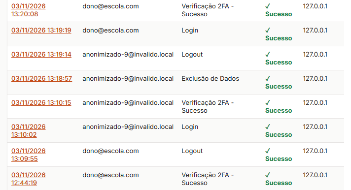

# Documentação — Conformidade com a LGPD (RLGPD 4.1 a RLGPD 4.11)

**Projeto:** ERP Escola Profissionalizante  
**Autores:** Marcos Antônio Ferreira de Araújo e Matheus de Castro Viana  
**Versão do Documento de Requisitos:** 1.1  
**Data da implementação:** 13 de setembro de 2026  
**Entrega:** Projeto Integrador - Conformidade com a LGPD  

---

## Listagem completa dos dados pessoais coletados

**Requisito:** O projeto deverá apresentar uma listagem completa dos dados pessoais coletados pelo sistema.

### Decisão adotada

O inventário de dados pessoais foi documentado no arquivo `docs/lgpd/inventario_dados.md`, organizado por grupo de dados (Funcionário, Aluno, Responsável) e contendo as seguintes colunas para cada dado:

- **Grupo:** Categoria do dado (Identificação, Contato, Profissional, Acadêmico, Financeiro, Logs de Segurança)
- **Dado:** Campo específico coletado
- **Titular:** Pessoa a quem o dado se refere
- **Finalidade:** Razão pela qual o dado é coletado
- **Acesso:** Perfis de usuário que podem visualizar o dado

O inventário está versionado e inclui um histórico de alterações, permitindo rastreabilidade de modificações futuras conforme novos módulos forem implementados.

### Justificativa técnica

A organização em grupos de dados facilita a compreensão do escopo de coleta e permite que cada área (Administrativa, Pedagógica, Financeira) identifique rapidamente quais dados estão sob sua responsabilidade. A inclusão da coluna "Acesso" atende ao princípio de necessidade (art. 6º, III da LGPD), demonstrando que o acesso aos dados é restrito aos perfis com necessidade funcional.

### Evidências

- **Arquivo:** `docs/lgpd/inventario_dados.md`
- **Tabelas:** Funcionário (Usuário), Aluno (módulo futuro), Responsável (módulo futuro)
- **Histórico de alterações:** Versionamento documentado no final do arquivo

---

## Associação de cada dado a uma finalidade

**Requisito:** Cada dado pessoal deverá estar associado a uma finalidade de tratamento documentada.

### Decisão adotada

Cada dado listado no inventário (`docs/lgpd/inventario_dados.md`) possui a coluna **Finalidade** explicitamente preenchida, descrevendo a razão específica para a coleta. Exemplos:

- **Nome e CPF:** "Identificação do colaborador"
- **Telefone:** "Comunicação institucional"
- **Cargo:** "Controle de acesso e permissões"
- **Jornada:** "Gestão administrativa da rotina"
- **Email (logs):** "Autenticação e controle de acesso"
- **IP (logs):** "Auditoria e rastreabilidade"

### Justificativa técnica

A associação explícita entre dado e finalidade atende ao **princípio da finalidade** (art. 6º, I da LGPD), que exige que o tratamento de dados pessoais seja realizado para propósitos legítimos, específicos e explícitos. Isso também facilita a resposta a solicitações de titulares que questionem por que determinado dado está sendo coletado.

### Evidências

- **Arquivo:** `docs/lgpd/inventario_dados.md` (coluna "Finalidade" preenchida para todos os dados)

---

## Evidência de minimização de dados

**Requisito:** O projeto deverá apresentar evidência de minimização de dados, justificando a necessidade dos campos coletados.

### Decisão adotada

A minimização de dados foi aplicada em duas frentes:

1. **No inventário:** A seção "O que é excluído de fato (RF 4.10)" do `inventario_dados.md` documenta explicitamente quais dados **não podem** ser excluídos e por quê.

2. **Na implementação:** O sistema coleta apenas os campos estritamente necessários para cada funcionalidade:
   - **Login:** Apenas e-mail e senha (não solicitamos nome de usuário, data de nascimento, etc.)
   - **Cadastro de funcionário:** Nome, CPF, telefone, cargo e setor são essenciais para identificação única, controle de acesso e comunicação
   - **Auditoria:** IP e user-agent são mínimos necessários para investigação de incidentes

3. **Dados NÃO coletados:**
   - **Data de nascimento:** Não é necessária para as funcionalidades atuais
   - **Endereço residencial:** Sem finalidade definida no escopo atual
   - **RG ou outros documentos:** CPF é suficiente para identificação fiscal
   - **Foto ou biometria:** Sem necessidade para autenticação (2FA via TOTP é suficiente)
   - **Dados bancários:** Serão tratados apenas no módulo financeiro futuro, com criptografia adicional

### Justificativa técnica

O **princípio da necessidade** (art. 6º, III da LGPD) exige que o tratamento de dados pessoais seja limitado ao mínimo necessário para a realização de suas finalidades. Ao documentar explicitamente quais dados são coletados e por quê, e ao justificar a não-coleta de outros dados, o sistema demonstra conformidade com este princípio e reduz o risco de tratamento excessivo ou inadequado.

### Evidências

- **Arquivo:** `docs/lgpd/inventario_dados.md` (seção "O que é excluído de fato")
- **Implementação:** Formulários de cadastro e login coletam apenas campos essenciais
- **Código:** `usuarios/models.py` (modelo Usuario com campos mínimos: email, funcionario, tentativas_login_falhas, bloqueado_ate)

---

## Registro explícito de consentimento

**Requisito:** Quando o consentimento for utilizado como base aplicável, o sistema deverá registrar o consentimento de forma explícita.

### Decisão adotada

O consentimento é solicitado **exclusivamente após** o usuário completar o login e a validação do 2FA. O `ConsentimentoMiddleware` intercepta a requisição e, caso o usuário não tenha consentido, o redireciona para a tela dedicada `/usuarios/consentir/`. 

O fluxo de registro funciona da seguinte forma:
1. O usuário visualiza o popup com os termos e clica em "Aceitar e Continuar".
2. O frontend envia uma requisição `POST` para a API `/usuarios/api/consentimento/` com o tipo e a versão do consentimento.
3. O backend valida o pedido contra um catálogo fechado: o `tipo` precisa ser uma das finalidades definidas no modelo e a `versao` precisa ser a versão **ativa** cadastrada em `VersaoTextoConsentimento` para aquele tipo. Tipo desconhecido, versão inexistente ou versão inativa resultam em resposta `400` e **nada é gravado**. O texto que gera o hash vem sempre do banco, nunca do cliente.
4. Um registro **imutável** é criado no modelo `ConsentimentoLGPD`, contendo o hash SHA-256 do texto apresentado, IP, User-Agent e URL de origem.
5. O botão "Recusar e Sair" utiliza um formulário com método `POST` direcionado à rota de logout, garantindo conformidade com as boas práticas de segurança (evitando logout via GET).
6. O valor `aceitou` é interpretado de forma estrita (inclusive quando chega como o texto `"false"`). Uma recusa grava um registro com status `recusado` e o acesso ao sistema continua bloqueado até que haja um novo consentimento.
7. Cada aceite ou recusa também gera um evento do tipo `consentimento_lgpd` no `LogAuditoria` (veja `docs/auditoria_logs.md`).

### Justificativa técnica

O registro explícito e centralizado no banco de dados atende ao **art. 8º da LGPD**, garantindo que a manifestação de vontade seja comprovável e vinculada à identidade do usuário autenticado. A remoção da dependência exclusiva do `localStorage` para a validação principal elimina vulnerabilidades de manipulação client-side. O uso de POST no logout previne ataques CSRF.

### Evidências

- **Arquivos:** `usuarios/templates/usuarios/consentimento_popup.html`, `static/auth/js/lgpd_consent.js`
- **Print:** `docs/evidencias/popup-de-consentimento.png`
- **Log de auditoria:** tabela `usuarios_logauditoria`, eventos `consentimento_lgpd`
- **Código:** `usuarios/middleware.py::ConsentimentoMiddleware` e `usuarios/views_lgpd.py::registrar_consentimento_view`

---

## Consentimento associado à finalidade

**Requisito:** O consentimento deverá estar associado à finalidade específica apresentada ao titular.

### Decisão adotada

O popup de consentimento exibe explicitamente as finalidades do tratamento de dados:

> "Seus dados são utilizados estritamente para autenticação, segurança, auditoria e finalidades administrativas do ERP. Você pode revogar este consentimento a qualquer momento em 'Meus Dados'."

No backend, a view `registrar_consentimento_view` recebe e valida rigidamente o parâmetro `tipo` (ex: `'tratamento_dados'`) contra as escolhas permitidas no modelo. Além disso, o sistema busca a `VersaoTextoConsentimento` ativa no banco para aquele tipo, calcula o hash SHA-256 do texto oficial e o salva junto ao registro do usuário, garantindo que o consentimento esteja inequivocamente atrelado ao texto e à finalidade vigentes naquele momento.

### Justificativa técnica

A associação rígida entre consentimento, versão do texto e finalidade atende ao **art. 8º, §1º e §2º da LGPD**. O uso do hash do texto garante a integridade da prova de consentimento, impedindo que alegações futuras sobre "qual texto foi apresentado" sejam contestadas.

### Evidências

- **Código:** `usuarios/models.py::VersaoTextoConsentimento` e `ConsentimentoLGPD`
- **Código:** `usuarios/views_lgpd.py::registrar_consentimento_view` (cálculo do `texto_hash` e validação do `tipo`)

---

## Possibilidade de revogação do consentimento

**Requisito:** O sistema deverá permitir o registro da revogação do consentimento quando o tratamento estiver fundamentado nessa hipótese.

### Decisão adotada

Ao clicar em revogar:
1. O sistema **não apaga** o registro original (preservando a trilha de auditoria e a imutabilidade dos logs).
2. O método `revogar()` do modelo cria um **novo registro** na tabela `ConsentimentoLGPD` com o `status` definido como `'revogado'`, registrando a `data_revogacao` e o IP do momento da ação.
3. Um evento do tipo `consentimento_lgpd` (com `evento_lgpd = revogacao_consentimento`) é registrado no `LogAuditoria`, na mesma trilha dos aceites e recusas, para rastreabilidade administrativa.

A revogação só é aceita para o consentimento **aceito e vigente** da finalidade. Tentar revogar um registro antigo (já substituído por outro mais recente), uma recusa ou um registro já revogado não grava nada e exibe uma mensagem informativa; isso evita revogações duplicadas na trilha.

**Interrupção do tratamento após a revogação.** O `ConsentimentoMiddleware` considera sempre o último registro de cada finalidade. Quando esse registro é `revogado`, as telas do sistema passam a redirecionar o usuário para `/usuarios/consentir/` (as exceções são a própria tela de consentimento, a gestão de consentimentos em `/usuarios/meus-dados/consentimentos/`, o logout, a Política de Privacidade, os Termos de Uso e as rotas de ativação do 2FA). O tratamento dos dados pelo sistema deixa de ocorrer para aquele usuário até que ele consinta novamente, o que gera um novo registro `aceito`. A tela de gestão continua acessível para que o titular consulte o histórico que comprova a revogação. O Django Admin, de uso restrito à equipe, não é interceptado por esse middleware.

### Justificativa técnica

O **art. 8º, §5º da LGPD** estabelece que o titular pode revogar o consentimento a qualquer momento. A abordagem de criar um novo registro de revogação (em vez de deletar ou alterar o anterior) é a prática recomendada de segurança da informação e auditoria, pois mantém o histórico completo das ações do titular, provando que o tratamento foi legítimo até o momento da revogação.

### Evidências

- **Código:** `usuarios/views_lgpd.py::revogar_consentimento` e `usuarios/models.py::ConsentimentoLGPD.revogar`
- **Código:** `usuarios/middleware.py::ConsentimentoMiddleware` (bloqueio após a revogação)
- **Testes:** `usuarios/test_consentimento.py` (revogação grava `revogado`, registra o log, interrompe o acesso e permite consentir de novo)
- **Código:** `usuarios/audit.py::registrar_evento_lgpd` (evento `revogacao_consentimento`) e `usuarios/audit.py::registrar_consentimento` (aceite e recusa)
- **Arquivo:** `usuarios/templates/usuarios/politica_privacidade.html` (seção "10. Contato" com e-mail do DPO)

---

## Registro de data e versão do consentimento

**Requisito:** O sistema deverá registrar a data, hora, versão do texto e contexto do consentimento ou da revogação.

### Decisão adotada

O modelo `ConsentimentoLGPD` armazena de forma estruturada e imutável no banco de dados PostgreSQL os seguintes campos de contexto para cada ação:
- `usuario`: Vínculo com o usuário autenticado.
- `tipo` e `versao`: Identificação da finalidade e da versão do texto.
- `texto_hash`: Hash SHA-256 do texto exato apresentado ao usuário.
- `status`: `'aceito'`, `'recusado'` ou `'revogado'`.
- `ip_address` e `user_agent`: Contexto técnico da requisição.
- `url_origem`: Página onde a ação foi realizada.
- `data_consentimento` e `data_revogacao`: Timestamps automáticos do banco.

Qualquer tentativa de executar `update()` ou `delete()` neste modelo via Django ORM lança uma exceção `PermissionDenied`, garantindo a imutabilidade exigida para fins de auditoria.

### Justificativa técnica

O registro detalhado do contexto atende plenamente ao **art. 8º, §2º da LGPD**, que exige que o controlador possa comprovar o consentimento. A imutabilidade via `QuerySet` personalizado e a sobrescrita dos métodos `save` e `delete` no modelo impedem alterações e exclusões feitas pela aplicação (ORM, Django Admin e views). Essa proteção é de nível de aplicação: diferentemente da tabela `LogAuditoria`, a tabela `usuarios_consentimentolgpd` ainda não possui trigger no PostgreSQL, então um usuário com acesso direto ao banco poderia alterá-la por SQL. Uma melhoria possível é replicar para ela o trigger de imutabilidade criado na migration `0013`.

### Evidências

- **Código:** `usuarios/models.py::ConsentimentoLGPD` (campos e métodos `save`/`delete` protegidos)
- **Código:** `usuarios/models.py::ConsentimentoLGPDQuerySet` (bloqueio de `update` e `delete` em massa)

## Funcionalidade de consulta aos dados do titular

**Requisito:** O sistema deverá disponibilizar funcionalidade de consulta aos dados pessoais do titular, conforme o perfil e o procedimento definido.

### Decisão adotada

Implementada a view consultar_dados (usuarios/views_lgpd.py) acessível via /usuarios/meus-dados/, que exibe todos os dados pessoais do usuário logado organizados em seções:

- **Dados da Conta:** E-mail, data de criação, status do 2FA
- **Dados Funcionais:** Nome, CPF, telefone, cargo, setor (se aplicável)
- **Jornada de Trabalho:** Dias e horários (se aplicável)

A view é protegida pelo decorator @login_required, garantindo que apenas o próprio titular (ou um administrador com permissões específicas) possa acessar os dados.

### Justificativa técnica

A funcionalidade de consulta atende ao art. 18, I da LGPD, que garante ao titular o direito de confirmar a existência de tratamento e acessar seus dados pessoais. A organização em seções facilita a compreensão do titular sobre quais dados estão sendo tratados.

### Evidências

- **Arquivo:** `usuarios/templates/usuarios/consultar_dados.html`
- **Código:** `usuarios/views_lgpd.py::consultar_dados`

## Funcionalidade de exportação dos dados

**Requisito:** O sistema deverá disponibilizar funcionalidade de exportação dos dados pessoais do titular em formato estruturado ou em formato definido pelo projeto.

### Decisão adotada

Implementada a view exportar_dados `(usuarios/views_lgpd.py)` acessível via `/usuarios/meus-dados/exportar/`, que gera um arquivo JSON contendo todos os dados pessoais do usuário:

```javascript
{
  "conta": {
    "email": "usuario@email.com",
    "data_criacao": "2026-09-13T18:00:00",
    "dois_fatores_ativo": true
  },
  "funcionario": {
    "nome": "João Silva",
    "cpf": "123.456.789-00",
    "telefone": "(11) 99999-9999",
    "cargo": "Professor",
    "setor": "Pedagógico"
  },
  "jornadas": [
    {
      "dia_semana": "Segunda-feira",
      "hora_inicio": "08:00",
      "hora_fim": "17:00"
    }
  ]
}
```
O arquivo é disponibilizado para download com o nome meus_dados.json, em formato legível e estruturado.

### Justificativa técnica

A exportação em JSON atende ao art. 18, V da LGPD (portabilidade dos dados), permitindo que o titular transfira seus dados para outro sistema. O formato JSON é amplamente suportado e facilita a interoperabilidade entre sistemas.

### Evidências

- **Código:** `usuarios/views_lgpd.py::exportar_dados`

## Funcionalidade de exclusão dos dados pessoais

**Requisito:** O sistema deverá disponibilizar funcionalidade de exclusão dos dados pessoais quando houver fundamento e autorização para a exclusão, preservando registros que precisem ser mantidos por obrigação válida.

### Decisão adotada

Implementado o fluxo de solicitação de exclusão com aprovação da Gestão (RF 4.10), acessível via `/usuarios/meus-dados/exclusao/`. O fluxo funciona da seguinte forma:

1. **O titular solicita:** na tela de exclusão, o titular clica em "Confirmar solicitação de exclusão". O sistema cria uma `SolicitacaoExclusao` com status **PENDENTE** e registra no log de auditoria. Nenhum dado é alterado neste passo.
2. **A Gestão analisa:** no Django Admin (`/admin/usuarios/solicitacaoexclusao/`), a Gestão visualiza a fila de solicitações pendentes e pode:
   - **Aprovar:** executa a anonimização/exclusão dos dados. A aprovação e a execução rodam dentro de um mesmo `transaction.atomic()`: se qualquer passo falhar, nada é gravado e a solicitação continua PENDENTE.
   - **Recusar:** mantém todos os dados intactos, registra justificativa e quem decidiu. A recusa só é aceita com justificativa preenchida.
3. **Execução (após aprovação):** a função `executar_exclusao()` roda dentro de `transaction.atomic()` e:
   - Recusa a execução se o status não for `APROVADA` ou se já foi executada anteriormente.
   - Anonimiza o **nome** do funcionário (troca por `Titular anonimizado #<id>`).
   - Anonimiza o **CPF** (troca por valor não identificável, mantido cifrado) e o **cpf_indice** (recalculado com índice cego de valor não identificável, mantendo unicidade).
   - Anonimiza o **telefone** (zera o campo).
   - Marca o funcionário como **inativo** (`ativo = False`).
   - Apaga as **jornadas de trabalho** vinculadas.
   - Anonimiza o **e-mail** do usuário (troca por `anonimizado-<id>@invalido.local`).
   - Torna a senha **inutilizável** (`set_unusable_password`).
   - Marca o usuário como **inativo** (`is_active = False`).
   - Invalida a **chave TOTP** (apaga `chave_secreta` e desativa `ativado`).
   - Apaga os **tokens de recuperação de senha** (contêm IP e user-agent).
   - Marca o `executado_em` na solicitação.
   - Registra o evento no `LogAuditoria` (apenas IDs, sem CPF, telefone ou e-mail).

### O que fica retido (por obrigação legal / contratual)
- **Nome e CPF** (`cpf` e `cpf_indice`): substituídos por valores não identificáveis, mas a linha do Funcionario é mantida por causa de FKs `PROTECT` e obrigações trabalhistas.
- **LogAuditoria**: imutável por obrigação de segurança e rastreabilidade (LGPD art. 16).
- **ConsentimentoLGPD**: prova de consentimento do titular (LGPD art. 8º, §2º).
- **SolicitacaoExclusao**: prova do atendimento ao direito do titular (LGPD art. 18).
- **Cargo/Setor**: não identificam a pessoa individualmente, são mantidos.

### O que é anonimizado
- Nome do funcionário
- CPF e cpf_indice do funcionário
- Telefone do funcionário
- Jornadas de trabalho (apagadas)
- E-mail da conta
- Senha do usuário (tornada inutilizável)
- Chave secreta TOTP (2FA)
- Tokens de recuperação de senha

### Registros de auditoria
A tabela `LogAuditoria` é imutável e **não é alterada** pela exclusão. O evento de exclusão é registrado apenas com IDs (sem dados pessoais do titular).

### Evidências
- **Modelo:** `usuarios/models.py::SolicitacaoExclusao`
- **View do titular:** `usuarios/views_lgpd.py::solicitar_exclusao`
- **Execução:** `usuarios/views_lgpd.py::executar_exclusao`
- **Admin:** `usuarios/admin.py::SolicitacaoExclusaoAdmin` (actions Aprovar / Recusar)
- **Testes:** `usuarios/test_exclusao_lgpd.py`
- **Evidência de teste:** `docs/evidencias/saida_teste_exclusao_lgpd.txt`



## Fluxo de atendimento aos direitos documentado

**Requisito:** O projeto deverá documentar o fluxo de atendimento aos direitos do titular, incluindo solicitação, validação, análise, resposta, exportação, correção, revogação e exclusão quando aplicável.

### Decisão adotada

O fluxo de atendimento aos direitos do titular está documentado no arquivo docs/lgpd/inventario_dados.md, na seção "O que é excluído de fato (RF 4.10)", e complementado pela Política de Privacidade (usuarios/templates/usuarios/politica_privacidade.html), seção "7. Direitos do Titular".

O fluxo completo inclui:

- Consulta de Dados (RLGPD 4.8)
- Exportação de Dados (RLGPD 4.9)
- Exclusão de Dados (RLGPD 4.10)
- Revogação de Consentimento (RLGPD 4.6)

### Justificativa técnica

A documentação do fluxo de atendimento atende ao art. 18 da LGPD e às diretrizes da ANPD (Autoridade Nacional de Proteção de Dados), que recomendam que os controladores de dados estabeleçam procedimentos claros e prazos definidos para resposta às solicitações dos titulares. A automação de consultas e exportações reduz o tempo de resposta e melhora a experiência do titular.

### Evidências

- **Arquivo:** `docs/lgpd/inventario_dados.md` (seção "O que é excluído de fato")
- **Arquivo:** `usuarios/templates/usuarios/politica_privacidade.html` (seção "7. Direitos do Titular")
- **Arquivo:** `usuarios/templates/usuarios/termos_uso.html` (seção "6. Privacidade")

## Histórico de alterações

| Versão | Data | Alteração | Responsável |
|---|---|---|---|
| 1.0 | 12/09/2026 | Primeira versão do documento | Marcos Antônio Ferreira de Araújo |
| 1.1 | 12/09/2026 | Documentadas as funcionalidades de consulta, exportação e exclusão de dados | Marcos Antônio Ferreira de Araújo |
| 1.2 | 03/11/2026 | Atualização no fluxo de exclusão com solicitação e aprovação do admin | Marcos Antônio Ferreira de Araújo |
| 1.3 | 04/11/2026 | Consentimento persistido no banco com validação de finalidade e versão no servidor, revogação que interrompe o tratamento e correções (nome do arquivo exportado e escopo da imutabilidade) | Matheus de Castro Viana |
