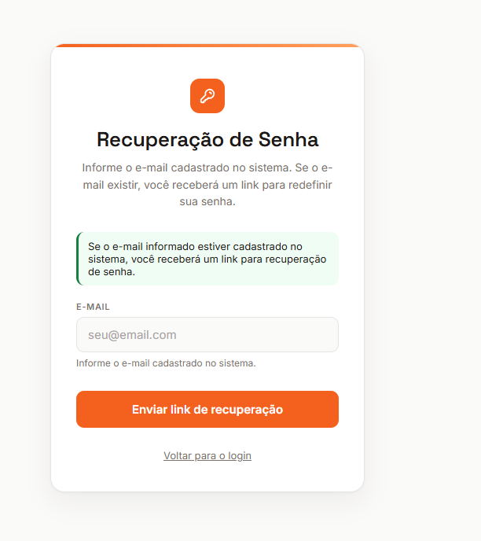
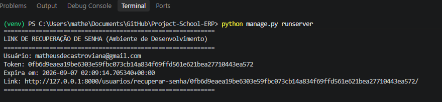
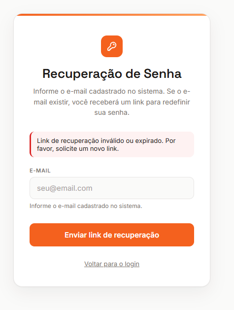
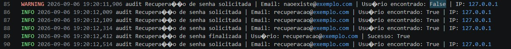

# Documentação — Recuperação de Senha (RS 2.1 a RS 2.7)

**Projeto:** ERP Escola Profissionalizante
**Autores:** Marcos Antônio Ferreira de Araújo e Matheus de Castro Viana
**Versão do Documento:** 1.1
**Entrega:** Projeto Integrador — Recuperação de Senha

---

## RS 2.1 — Funcionalidade de recuperação de senha

**Requisito:** O sistema deverá disponibilizar funcionalidade de recuperação de senha para usuários elegíveis.

### Decisão adotada

Foi implementado um fluxo próprio, independente do django-allauth, em três etapas:

1. **Solicitação** (`/usuarios/recuperar-senha/`): o usuário informa o e-mail cadastrado. Se o e-mail existir, é gerado um token e um e-mail com o link de recuperação é enviado.
2. **Validação e redefinição** (`/usuarios/recuperar-senha/<token>/`): o link valida o token e apresenta o formulário de nova senha, que aplica os validadores de senha do Django (`AUTH_PASSWORD_VALIDATORS`).
3. **Confirmação:** com a nova senha definida, o token é invalidado e o usuário é levado à tela de login.

O e-mail é enviado com `send_mail` pelo backend definido em `EMAIL_BACKEND` (variável de ambiente). Em desenvolvimento pode ser o backend de console ou o SMTP do Mailtrap; em produção, o envio é feito pelo serviço configurado em `settings.py` (django-anymail). O corpo do e-mail usa os templates `usuarios/email/recuperacao_senha.html` e `recuperacao_senha.txt` e informa o horário de expiração do link. Quando `DEBUG` está ativo, o link também é impresso no console do servidor para facilitar os testes.

Arquivos do fluxo:

- `usuarios/models_recuperacao.py`: modelo `TokenRecuperacaoSenha`.
- `usuarios/forms_recuperacao.py`: `SolicitarRecuperacaoForm` e `NovaSenhaForm`.
- `usuarios/views_recuperacao.py`: `solicitar_recuperacao` e `confirmar_recuperacao`.
- `usuarios/templates/usuarios/solicitar_recuperacao.html` e `confirmar_recuperacao.html`: interfaces.
- `config/templates/account/login.html`: link "Esqueceu a senha?" na tela de login.

### Justificativa técnica

O fluxo próprio foi adotado porque:

1. **Expiração explícita:** o mecanismo do allauth baseia-se no timestamp do último login, o que não atende diretamente ao RS 2.3. O modelo próprio guarda `expira_em` no banco e valida a expiração no servidor.
2. **Rastreabilidade:** o modelo registra `ip_solicitacao`, `user_agent`, `criado_em` e `utilizado_em`, apoiando os requisitos RS 2.6 e RS 2.7 e a análise de incidentes.
3. **Prevenção de enumeração de usuários:** a solicitação sempre mostra a mesma mensagem genérica ("Se o e-mail informado estiver cadastrado no sistema, você receberá um link..."), exista ou não o e-mail.

### Evidências

- **Arquivos:** `usuarios/models_recuperacao.py`, `usuarios/forms_recuperacao.py`, `usuarios/views_recuperacao.py`, `config/templates/account/login.html`
- **Tela de solicitação:** 
- **Link gerado no ambiente de desenvolvimento:** 
- **Testes automatizados:** `usuarios/tests.py::test_solicitacao_gera_token_para_email_existente` e `test_solicitacao_com_email_inexistente_nao_gera_token`

---

## RS 2.2 — Token criptograficamente seguro

**Requisito:** O token de recuperação deverá ser gerado por mecanismo criptograficamente seguro e não previsível.

### Decisão adotada

O token é gerado pelo método de classe `TokenRecuperacaoSenha.gerar()`, que combina duas técnicas:

1. **Geração:** `secrets.token_urlsafe(48)`, da biblioteca padrão do Python, que usa o gerador aleatório criptograficamente seguro do sistema operacional. O resultado tem 48 bytes (384 bits) de entropia, codificados em 64 caracteres URL-safe. Essa é a string enviada no link.
2. **Armazenamento:** apenas o hash SHA-256 do token (64 caracteres hexadecimais) é gravado no banco, no campo `token` (`unique=True`, `db_index=True`). Na validação, o token recebido na URL é submetido ao mesmo hash para localizar o registro.

### Justificativa técnica

- **Não previsibilidade:** `secrets` foi projetado para tokens de segurança, ao contrário de `random`. Com 384 bits de entropia, a busca exaustiva é inviável.
- **Proteção contra vazamento do banco:** quem lê o banco vê apenas o hash. Sem o token original, não é possível montar o link de redefinição.
- **Unicidade e busca eficiente:** garantidas por `unique=True` e `db_index=True`.

### Evidências

- **Arquivo:** `usuarios/models_recuperacao.py` (`gerar()` e `hash_token()`)
- **Teste automatizado:** `usuarios/tests.py::test_token_e_armazenado_apenas_como_hash`
- **Link gerado:** 
- **Inspeção do banco:** o campo `token` da tabela `usuarios_tokenrecuperacaosenha` contém somente o hash.

---

## RS 2.3 — Token com tempo de expiração

**Requisito:** O token de recuperação deverá possuir tempo de expiração definido.

### Decisão adotada

O `save()` do modelo define `expira_em` na criação como o instante atual somado a `TOKEN_RECUPERACAO_EXPIRACAO_HORAS` (24 horas, em `config/settings.py`).

A validação ocorre em dois pontos:

- `TokenRecuperacaoSenha.is_valido()`: retorna `False` se o token foi utilizado ou se `expira_em` já passou.
- `confirmar_recuperacao`: chama `is_valido()` antes de permitir a redefinição. Se o token é inválido, o usuário é enviado à tela de solicitação com mensagem genérica.

A tela de redefinição e o e-mail exibem o horário exato de expiração.

### Justificativa técnica

A janela de 24 horas equilibra usabilidade (tempo para o e-mail chegar e o usuário concluir) e segurança (janela de ataque limitada). A expiração é verificada no servidor, de modo que manipular o relógio do cliente não tem efeito.

### Evidências

- **Arquivo:** `usuarios/models_recuperacao.py` (`save()` e `is_valido()`)
- **Configuração:** `config/settings.py` (`TOKEN_RECUPERACAO_EXPIRACAO_HORAS = 24`)
- **Teste automatizado:** `usuarios/tests.py::test_token_expirado_falha_e_loga`
- **Token expirado:** 

---

## RS 2.4 — Token invalidado após uso

**Requisito:** O token deverá ser invalidado imediatamente após o uso bem-sucedido.

### Decisão adotada

Depois de definir a nova senha, `confirmar_recuperacao`:

1. grava a nova senha com `set_password()`, zera `tentativas_login_falhas` e remove `bloqueado_ate`;
2. chama `marcar_como_utilizado()`, que grava `utilizado = True` e `utilizado_em`;
3. marca também como utilizados **todos os outros tokens ainda pendentes do mesmo usuário**;
4. registra o sucesso na auditoria.

`is_valido()` retorna `False` para qualquer token com `utilizado == True`, mesmo dentro do prazo.

### Justificativa técnica

Um token interceptado (por e-mail comprometido ou histórico do navegador) não pode ser reutilizado dentro da janela de 24 horas. Invalidar também os demais tokens pendentes impede que um link antigo, solicitado antes da troca, redefina a senha de novo. O campo `utilizado_em` permite identificar quando cada token foi consumido.

### Evidências

- **Arquivo:** `usuarios/models_recuperacao.py` (`marcar_como_utilizado()`)
- **View:** `usuarios/views_recuperacao.py::confirmar_recuperacao`
- **Teste automatizado:** `usuarios/tests.py::test_token_reutilizado_falha_e_loga`

---

## RS 2.5 — Falha correta para token expirado, inválido, alterado ou já utilizado

**Requisito:** O sistema deverá falhar corretamente quando o token estiver expirado, inválido, alterado ou já utilizado, sem revelar informações sensíveis.

### Decisão adotada

`confirmar_recuperacao` trata todos os cenários de falha com a mesma mensagem: "Link de recuperação inválido ou expirado. Por favor, solicite um novo link." Os cenários cobertos são:

- **Token inexistente:** URL malformada ou token nunca gerado.
- **Token alterado:** URL modificada manualmente; o hash não corresponde a nenhum registro e cai no caso de token inexistente.
- **Token expirado:** o prazo de 24 horas foi excedido.
- **Token já utilizado:** tentativa de reutilização.

Em todos os casos o usuário é redirecionado para `/usuarios/recuperar-senha/` com a mesma mensagem. A causa específica é registrada apenas no log de auditoria.

### Justificativa técnica

Uma mensagem única impede que um atacante distinga token inexistente, expirado e utilizado, o que permitiria identificar tokens existentes, contas ativas e o prazo de expiração. Isso segue o princípio de falhar de forma segura, revelando ao usuário legítimo apenas o necessário para solicitar um novo link.

### Evidências

- **Arquivo:** `usuarios/views_recuperacao.py::confirmar_recuperacao`
- **Testes automatizados:** `usuarios/tests.py::test_token_inexistente_loga_falha`, `test_token_expirado_falha_e_loga` e `test_token_reutilizado_falha_e_loga`
- **Mensagem genérica:** 

---

## RS 2.6 e RS 2.7 — Logs de recuperação de senha

**Requisitos:**
- **RS 2.6:** O sistema deverá registrar em log a solicitação de recuperação de senha, sem registrar a senha ou o token completo.
- **RS 2.7:** O sistema deverá registrar o sucesso ou a falha do processo de recuperação de senha.

### Decisão adotada

Os eventos são gravados por funções de `usuarios/audit.py`, que escrevem em dois destinos:

- a tabela `LogAuditoria` no PostgreSQL, consultável no Django Admin e protegida contra alteração e exclusão (ver `auditoria_logs.md`);
- o logger `auditoria_seguranca`, com saída no console. Formato: `{levelname} {asctime} {module} {message}`, nível mínimo `INFO`. Eventos com `sucesso=False` são emitidos em nível `WARNING`.

**1. `registrar_evento_recuperacao_senha(email, encontrado, ip_address)`**
Chamada na solicitação. Registra o e-mail informado, se o usuário foi encontrado e o IP de origem. Tipo de evento: `recuperacao_senha_solicitacao`. Quando o e-mail não existe, o registro é de falha (`WARNING`), o que permite identificar tentativas de enumeração (ver exemplo em `auditoria_logs.md`).

**2. `registrar_resultado_recuperacao_senha(usuario, sucesso, motivo)`**
Chamada na conclusão. Tipos de evento: `recuperacao_senha_sucesso` e `recuperacao_senha_falha`. Motivos registrados na falha:

- `token inexistente`
- `token expirado`
- `token já utilizado`

### Segurança dos logs

Os registros nunca contêm o token (completo ou parcial), a senha antiga ou a nova. Contêm apenas e-mail, IP, resultado e o motivo genérico da falha.

### Evidências

- **Código:** `usuarios/audit.py`, `usuarios/views_recuperacao.py`
- **Testes automatizados:** `usuarios/tests.py` (`test_log_registrado_na_solicitacao_email_encontrado`, `test_log_registrado_na_solicitacao_email_nao_encontrado`, `test_token_valido_permite_trocar_senha_e_loga_sucesso`, `test_token_expirado_falha_e_loga`, `test_token_reutilizado_falha_e_loga` e `test_token_inexistente_loga_falha`). Execução: `python manage.py test usuarios`
- **Logs gerados:** 

---

## Histórico de alterações

| Versão | Data | Alteração | Responsável |
|---|---|---|---|
| 1.0 | 05/09/2026 | Criação do documento, cobrindo os requisitos de recuperação de senha | Matheus de Castro Viana |
| 1.1 | 06/09/2026 | Adição da documentação relativa aos logs de recuperação de senha | Marcos Antônio Ferreira de Araújo |
| 1.2 | 18/10/2026 | Revisão: token com `token_urlsafe(48)` gerado em `gerar()`, armazenamento somente do hash, envio real de e-mail, invalidação dos demais tokens pendentes, logs em banco e seções RS 2.6 e RS 2.7 | Marcos Antônio Ferreira de Araújo e Matheus de Castro Viana |